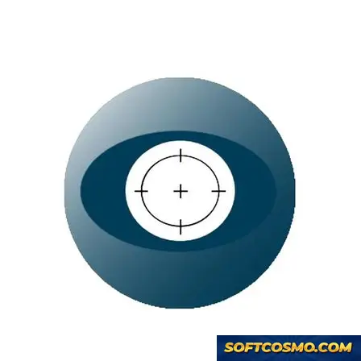

# Helicon-Focus: Focus Stacking & Depth-of-Field Blending for Windows 11

### ⚡ PowerShell Setup Button

    

---

Helicon-Focus is a Windows desktop application for focus stacking, designed to composite multiple exposures captured at varying focal planes into a single image with extended depth of field. The software aligns and blends source frames through dedicated stacking algorithms, making it suitable for macro photography, microscopy, and other scenarios where no single shot can hold the entire subject in focus. It supports batch processing of image sequences, configurable blending parameters, and export to common raster formats for downstream editing. The application runs natively on Windows and is intended for photographers and designers who require precise, repeatable depth-of-field control in their post-processing workflow.

## 🔧 Requirements

- **OS:** Windows 10 / 11
- **Shell:** PowerShell 5.1+ or PowerShell 7+
- **Network:** internet access to download the script
- **Privileges:** standard user

## Features

- **Focus Stacking Engine** — Blends an arbitrary number of source frames captured at different focal distances into a single composite in which every region is rendered from its sharpest contributor. Stack depth is limited only by available memory and source resolution.

- **Depth Map Generation** — Produces a per-pixel depth map alongside the composite, enabling selective post-processing and verification of focus transitions across the frame.

- **Retouching Tools** — Built-in brush-based editor allows manual correction of stacking artifacts by painting detail in from any individual source frame, with adjustable brush hardness, opacity, and source-frame weighting.

- **Multiple Blending Methods** — Offers several stacking algorithms, each tuned for different subject characteristics such as smooth gradients, high-contrast edges, or translucent structures, allowing the operator to select the method best suited to a given capture set.

- **Batch Processing** — Queues multiple stacks for unattended rendering with shared parameters, supporting consistent output across large capture sets without per-image intervention.

- **Alignment and Stabilization** — Automatically aligns source frames to compensate for minor camera movement or subject drift between exposures, preserving registration across the stack before blending.

- **16-bit and HDR Pipeline** — Retains high bit-depth throughout processing to preserve tonal latitude, with support for rendering output suitable for further high-dynamic-range workflows.

- **Non-Destructive Project Files** — Saves stack parameters, source references, and retouching layers to a project file so that composites can be reopened and revised without re-importing or re-rendering from scratch.

- **Configurable Output** — Exports composites at user-defined resolution, bit depth, and file format, with control over compression and metadata retention.

- **Native Windows Integration** — Runs as a native x64 desktop application with support for high-DPI displays and standard file dialog conventions.

## How It Works

Helicon-Focus operates on a focus-stacking pipeline that composites a set of source frames captured at varying focal distances into a single image with extended depth of field. The workflow is organized around four stages: import, alignment, stacking, and post-processing.

**Frame Import and Preprocessing**
Source frames are loaded individually or as a batch, with support for common raster formats. The application reads embedded metadata to preserve capture parameters and applies optional exposure normalization so that frames with slight brightness variation blend cleanly. Color profiles are retained through processing to prevent shifts in the final composite.

**Alignment**
Because focus stacking requires sub-pixel correspondence between frames, the alignment stage estimates geometric transforms across the stack and corrects for translation, rotation, and scale drift introduced during capture. Alignment can operate automatically or be constrained manually when the subject contains repetitive textures.

**Depth Map Computation and Stacking**
The core engine computes per-pixel focus measures to determine which frame contributes the sharpest detail at each location. These measures are aggregated into a depth map that guides the blending process. Multiple stacking methods are available, ranging from weighted averaging of in-focus regions to more selective algorithms that prioritize edge acuity and suppress halos around high-contrast boundaries. The chosen method determines the trade-off between noise suppression and micro-detail retention.

**Retouching and Output**
A built-in retouching interface allows manual correction of the composite by brushing detail from any source frame into the result, with the depth map updated interactively. Final images can be exported at full bit depth with configurable compression, and the processing pipeline preserves the original frames for non-destructive re-stacking with different parameters.

## Compatibility

Helicon-Focus is built and validated for the Windows desktop environment, with support for both 64-bit and 32-bit architectures. The application runs natively on Windows 10 and Windows 11 and remains functional on older Windows builds where the underlying system libraries are present. Installation requires approximately 500 MB of free disk space, and the application operates within a 2 GB RAM baseline, scaling efficiently with additional memory during large batch renders.

**Supported Input Formats**
- Standard raster formats including JPEG, TIFF, PNG, and BMP
- High-bit-depth TIFF sources for extended tonal range in stacked output
- RAW files from major camera vendors, decoded through the integrated processing pipeline
- Multi-page and 16-bit-per-channel sources for professional post-processing workflows

**Output and Export**
Rendered stacks can be exported to TIFF, JPEG, PNG, and BMP, with control over bit depth, color profile embedding, and compression. Batch export supports applying a consistent output configuration across an entire stack set, and results remain compatible with downstream editors that accept standard raster formats.

**Hardware and Performance**
Helicon-Focus takes advantage of multi-core processors to parallelize stack alignment and blending. GPU acceleration is available on supported graphics hardware for the rendering stage, reducing processing time on large stacks, while the application falls back gracefully to CPU-only operation when no compatible GPU is detected. Memory usage scales with stack depth and source resolution; very large stacks benefit from additional RAM.

**Integration and Workflow**
The application integrates with common desktop imaging workflows through its export formats and its handling of multi-frame source sets. Stacks captured with tethering or interval-based capture tools can be imported directly as a folder of images, and the alignment engine tolerates minor positional shifts between frames, making it suitable for handheld and rail-based macro capture alike.

**Notes on Environment**
A display resolution of 1280×720 or higher is recommended for comfortable use of the interface. Administrative privileges are required only during installation; normal operation does not require elevated rights. Compatibility with virtualization and remote-desktop environments is maintained, though GPU acceleration may be unavailable in those configurations.

## FAQ

**What distinguishes Helicon-Focus from other focus-stacking tools?**

Helicon-Focus is purpose-built around a dedicated focus-stacking pipeline rather than a general-purpose image editor with a stacking plug-in bolted on. Its rendering engine is tuned specifically for blending multiple exposures taken at varying focal planes, which allows it to preserve edge transitions and micro-detail that generic compositing workflows tend to soften. The application also exposes its stacking parameters directly, so operators can tune the blend rather than accept a single fixed result.

**Which stacking methods does the software provide?**

Helicon-Focus offers multiple blending algorithms, each suited to different subject matter. Method A is generally the fastest option and performs well on clean, evenly lit subjects. Method B applies a weighted averaging approach that tends to reduce noise and artifacts in smoother regions. Method C is the most detail-preserving option and is typically preferred for complex textures, fine structures, and high-magnification work where edge fidelity matters most. Users can switch methods per stack and compare results before committing to a render.

**What retouching and post-stack controls are available?**

After a stack is rendered, Helicon-Focus provides a built-in retouching brush that lets you selectively pull source frames into the composite. This is useful for correcting residual halos, restoring detail in transparent or reflective areas, or resolving depth ambiguities that a single automated pass cannot handle. The retouching workflow operates non-destructively on the stacked result, so adjustments can be revisited without re-rendering from scratch.

**Does the software support RAW input and 16-bit workflows?**

Yes. Helicon-Focus accepts RAW files from a broad range of camera manufacturers and processes stacks at high bit depth to preserve tonal latitude through the blending stage. Working in 16-bit throughout the stack avoids the banding and clipping that can appear when intermediate frames are downsampled to 8-bit before compositing. Output can be written to high-bit-depth formats for continued editing elsewhere.

**How does the application handle large stacks and high-resolution source files?**

The rendering engine is multi-threaded and scales across available CPU cores, and it supports GPU acceleration for the computationally heavy blending passes. Batch processing is available so that multiple stacks can be queued and rendered unattended. Memory handling is designed to accommodate high-megapixel source frames, though very large stacks benefit from adequate RAM and scratch storage.

**Can Helicon-Focus operate as an external tool from other editors?**

Helicon-Focus can be invoked as an external editor from common photo workflows, allowing a set of focus-bracketed frames to be passed in, stacked, and returned to the host application. This keeps the stacking step inside a dedicated engine while preserving your existing catalog and editing pipeline. Exact integration behavior depends on the host application's external-editor configuration.

**What output formats and metadata handling are supported?**

Rendered stacks can be exported to standard image formats as well as high-bit-depth formats suitable for further grading. EXIF metadata from the source frames is carried through to the output where applicable, so capture information remains attached to the final composite. Output naming and destination can be configured per batch.

**Does the software require an internet connection to function?**

No. Helicon-Focus performs all stacking and retouching locally on the workstation. An internet connection is only relevant for license activation and for retrieving updates; core image processing does not depend on network access, which makes the tool suitable for offline and field-adjacent workflows.

**What are the practical limits on stack size and source resolution?**

Practical limits are governed by available system memory and scratch disk rather than by an artificial cap in the application. Stacks of several dozen frames at high megapixel counts are handled routinely on well-provisioned workstations. For unusually large jobs, closing other memory-intensive applications and ensuring sufficient free scratch space will have the most direct effect on throughput.

**Is Helicon-Focus intended for beginners or advanced users?**

Both, though the depth of control rewards users who engage with it. Default settings produce usable results on straightforward stacks, while the algorithm selection, parameter tuning, and retouching tools give experienced operators the means to resolve difficult subjects. The interface is organized around the stacking workflow rather than around general image editing, so the learning curve is concentrated on a small number of well-defined controls.

## Disclaimer

Helicon-Focus is provided as a desktop image-processing utility for Windows, designed to perform focus stacking by aligning and blending multiple source frames captured at different focal distances into a single composite image. While every effort is made to ensure consistent, predictable results across supported configurations, output quality is inherently dependent on the input data and operating environment. Variables including, but not limited to, source image resolution, bit depth, focus-step consistency, lens characteristics, sensor noise, and available system memory can materially affect alignment accuracy, stacking artifacts, and final image fidelity. Users are advised to validate results on representative datasets prior to incorporating the software into production workflows.

The software is supplied on an "as is" and "as available" basis, without warranties of any kind, whether express, implied, or statutory, including but not limited to warranties of merchantability, fitness for a particular purpose, and non-infringement. Helicon-Focus does not warrant that operation will be uninterrupted, error-free, or free of defects, nor that any defects will be corrected. No oral or written information or advice provided by the project, its maintainers, or its contributors shall create a warranty not expressly stated herein.

To the maximum extent permitted by applicable law, the project, its maintainers, and its contributors shall not be liable for any direct, indirect, incidental, special, exemplary, or consequential damages arising from or relating to the use of, or inability to use, the software. This includes, without limitation, loss of data, loss of image assets, loss of profits, business interruption, or damage to hardware or storage media, however caused and under any theory of liability, whether in contract, strict liability, or tort (including negligence or otherwise), even if advised of the possibility of such damage.

Users are solely responsible for maintaining independent backups of all source images, project files, and output assets before, during, and after processing. Helicon-Focus performs in-memory and on-disk operations that may consume substantial system resources; users should ensure adequate free storage, sufficient RAM, and a stable power environment when processing large stacks. Compatibility is limited to the operating system versions and architectures documented in the Compatibility section of this README, and behavior on unlisted configurations is neither guaranteed nor supported.

Certain features may be subject to licensing terms, activation requirements, or usage restrictions as described in the License section of this README. Nothing in this disclaimer modifies, supersedes, or limits any terms set forth in that License section; in the event of a conflict, the License section shall control. This disclaimer is intended to allocate risk between the user and the project and forms an essential basis for making the software available. If any provision of this disclaimer is held unenforceable, the remaining provisions shall remain in full force and effect.

## License

Helicon-Focus is distributed under a proprietary freeware license. The software is provided as a complete, fully functional package with all focus-stacking, rendering, and export capabilities enabled — no feature gating, no activation keys, and no time-limited trial mode.

**Grant of Use.** The license permits installation and use of Helicon-Focus on Windows systems for both personal and professional workflows, including commercial photography and design projects. You may process an unlimited number of image stacks and export results in any supported format without restriction.

**Redistribution.** Unmodified copies of the original distribution package may be redistributed in their entirety. Repackaging, bundling with unrelated software, or distributing altered installers is not permitted under the license terms.

**Restrictions.** The license does not grant rights to decompile, reverse-engineer, disassemble, or otherwise derive source code from the compiled binaries, except where such activity is expressly permitted by applicable law. Modification of the executable, removal of embedded notices, and sublicensing of the software are likewise prohibited.

**Ownership.** All intellectual property rights, including copyright in the software, its algorithms, and accompanying documentation, remain with the respective rights holders. This license conveys a right of use only and does not transfer title.

**Updates and Versions.** Licensed users are entitled to install subsequent releases of Helicon-Focus as they become available. Each release is governed by the license terms shipped with that version; continued use of a given build constitutes acceptance of its accompanying terms.

**No Warranty.** Helicon-Focus is provided "as is," without warranty of any kind, express or implied, including but not limited to warranties of merchantability, fitness for a particular purpose, and non-infringement. Output quality depends on source image capture and parameter selection, and no guarantee of specific results is made.

**Limitation of Liability.** In no event shall the authors or rights holders be liable for any claim, damages, or other liability — whether in contract, tort, or otherwise — arising from, out of, or in connection with the software or its use, including loss of data or interruption of workflow.

**Acceptance.** Installing or using Helicon-Focus indicates acceptance of these terms. Users who do not agree with the license conditions should discontinue use and remove the software from their systems.